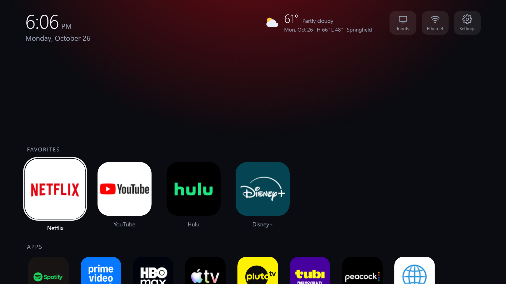
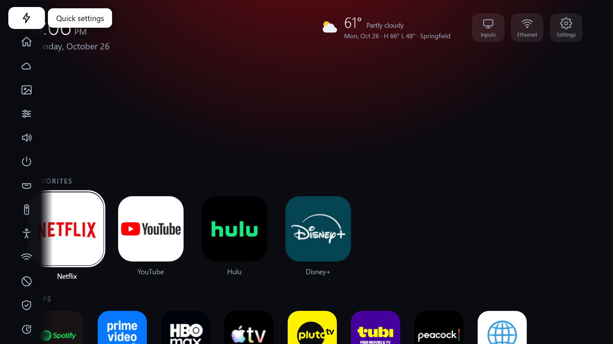
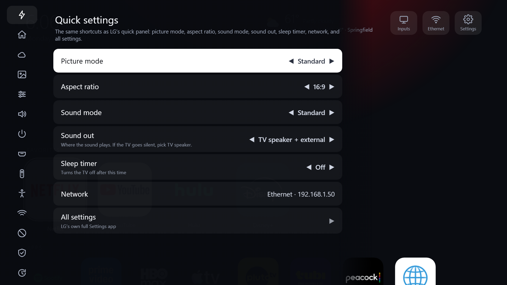
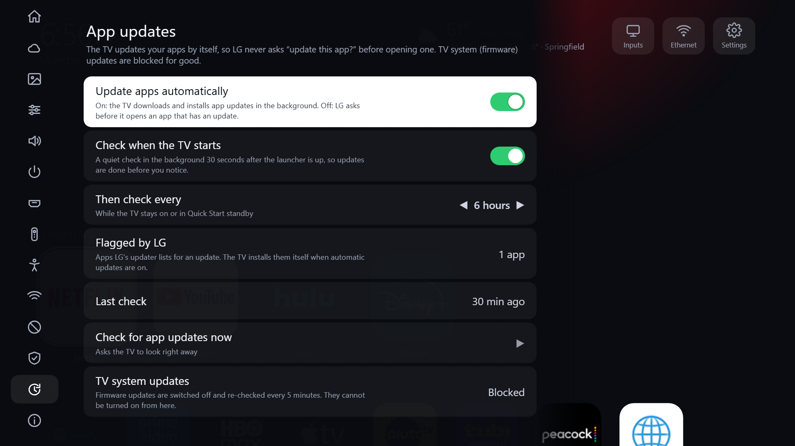
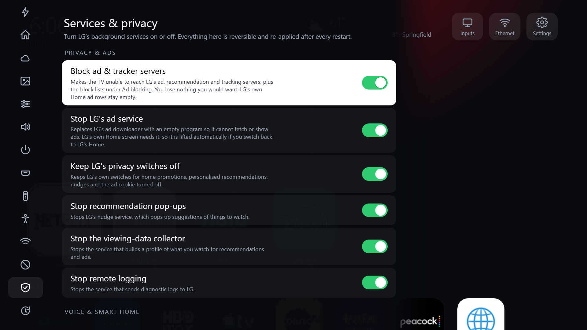

# Clean Home for LG webOS 4.x

**A faster, quieter LG TV.** An Apple-TV-style Home screen, a Settings screen that replaces LG's quick panel, a photo screensaver you manage from your phone,
an LG ads/telemetry cleanup, automatic app updates, and firmware updates that stay off. Built and tested on an **LG 55UM7300PUA (2019, webOS TV Lite 4.10.2 "webOS 4.5", Chromium 53)**
that is rooted with the Homebrew Channel. Everything is shell scripts plus plain HTML/JS: no Node on the TV, nothing written to system partitions, and one command undoes it all.



| | |
|---|---|
|  |  |
| The Settings key opens a slim icon rail; the name of the highlighted icon floats beside it. | OK unfolds a category next to the rail. **Quick settings** has everything LG's own quick panel has. |
|  |  |
| Apps update by themselves; firmware updates are blocked and cannot be turned on. | Every LG background service we stop is a switch with a plain-English description. |

*(Pictures are made with `PV_PUBLIC=1 node tools/preview.js`, which renders with no photos, a generic city and a generic IP. More: [Ad blocking](docs/images/settings-ad-blocking.png), [Remote & pointer](docs/images/settings-remote.png), [Picture](docs/images/settings-picture.png), [Home & Screensaver](docs/images/settings-home-screensaver.png), [Screensaver](docs/images/screensaver.png).)*

Inspired by [Gathin23/cleanyourtv](https://github.com/Gathin23/cleanyourtv) (Android) and [lasharor/cleanyourtv-WebOS](https://github.com/lasharor/cleanyourtv-WebOS) (webOS 5+, rooted),
which both skip webOS 4 (Upstart instead of systemd, no usable Node). See [NOTICE.md](NOTICE.md) for exactly what is borrowed.

## Contents
[Summary](#summary) · [Features](#features) · [Install](#install) · [Performance](#performance-analysis) · [Audit findings](#audit-findings) · [How it works](#how-it-works) · [Layout](#layout) · [Use](#use) · [Compatibility](#compatibility) · [Only a human can check](#only-a-human-with-the-remote-can-check)

## Summary
* **What it replaces:** LG's Home (a stand-in program bind-mounted over it that opens our web page through the web app manager), LG's gear-button quick panel (our overlay opens instead), LG's ad/telemetry background services (stopped or stubbed), LG's app-update prompts (apps update themselves), and LG's firmware updates (five blocking layers).
* **What it never touches:** firmware, bootloader, partitions (the root FS is read-only), Homebrew Channel, SSH/Telnet, inputs/HDMI, AirPlay/casting. Every change is runtime-only; a reboot without the one init hook is a stock TV.
* **Safety:** `./revert.sh`, a `DISABLE` flag, a 30 s "is the launcher alive" check that falls back to LG's Home, a crash-loop guard, an API watchdog, Telnet as an independent way in. Each is tested (`tools/safety-test.sh`).
* **Results:** cold Home 7.5 s -> 1.1 s, Home memory 150 MB -> about 90 MB (LG's own Home was 150 MB), swap 428 -> 250 MB, LG ad impressions dozens -> 0. Details and caveats below.
* **Portable:** one config file for the TV address, a read-only compatibility report, a guided installer, and a **rootless pack** (DNS block lists, an experimental dev-mode app, LG's own toggles) for TVs you cannot root.
* **Honest status:** a few things are unverified on real hardware (the pointer switch, an app update actually installing, the rootless IPK, the physical Back key on Home). They are listed in [Only a human can check](#only-a-human-with-the-remote-can-check) and in [docs/AUDIT.md](docs/AUDIT.md).

## Features

### Home and screensaver
* **Home**: clock, date, weather (Open-Meteo, Fahrenheit by default, ZIP or automatic), Inputs / Network / Settings buttons, a favorites row (Netflix, YouTube, Hulu, Disney+) with a colour glow, a grid of every other app, and your photos as a slowly rotating background.
* **Screensaver / AFK screen**: after idle time a clock, date and weather over a gallery photo, **dimmed twice**: the TV's **real backlight** goes down to 50 % (Settings -> Home & Screensaver -> Screensaver backlight; saves power; restored five independent ways, so a reboot or a crash can never leave the TV dim) and a software layer darkens the photo 30 % (Screensaver dimming) while the clock stays bright. The text drifts to avoid burn-in.
* **Back on Home** returns to the last app or input; **Back from an app** returns to the previous app and falls back to Home when there is none (switchable). Settings -> Remote & pointer has the Back options: forget where you were when the screensaver starts (default; or also when the TV goes off, or never), forget apps you left more than N minutes ago, how many steps back, and an optional *close apps I left on Home after N minutes* that frees memory (off by default: it also stops background music). Verified with injected key events (`tools/keys-test.sh`).
* **Pointer**: hover and click work on Home tiles, the Settings rail and rows, pop-up lists, the number pad and the QR page, and the **scroll wheel scrolls** those lists like Up/Down. To get rid of the arrow itself, three independent attempts are active (all **unverified**, see the audit): the compositor patch below (mouse events off, wheel key swallowed), a remote-side switch (arrow only after a shake, parked in a screen corner), and Home/Settings hiding the browser's own arrow.

### Settings (replaces LG's quick panel and most of LG's Settings app)
* The remote's **Settings (gear) key** opens our overlay: a **slim icon rail** that unfolds a category on OK and folds again on Back. The first icon, **Quick settings**, has exactly what LG's panel has (picture mode, aspect ratio, sound mode, sound out, sleep timer, network, all settings).
* Categories: Quick settings, Home & Screensaver, Weather, Photo gallery, Picture, Sound, Power & timers, Inputs & HDMI, Remote & pointer, Accessibility, Network, Ad blocking, Services & privacy, **App updates**, About & updates, and a link to LG's legacy Settings (Wi-Fi setup, accounts, channels). Values and option lists come from LG's own settings schema; about 90 LG keys are written and re-tested (`tools/lg-settings-test.sh`).
* **LG's quick panel never opens any more.** A switch in Services (*Hide LG's quick panel...*, on by default) loads patched copies of two of LG's key-filter scripts (generated on the TV from its own files plus our small snippets in `tv/qs/`, kept in RAM, never stored in this repo) into the display software, so the gear key does nothing in LG's code, LG's panel is not even pre-loaded any more (about 4 MB), and the key opens our overlay straight from the compositor (about 90 ms to launch, instead of 0.6-0.9 s waiting for the system log). It restarts the display software once (about 10 s of black screen), checks that everything came back, and rolls itself back (and, as a last resort, reboots into stock) if anything looks wrong. See [the audit](docs/AUDIT.md#4-the-settings-key-and-lgs-quick-panel).

### Photo gallery from the TV and your phone
* *Settings -> Photo gallery* shows your photos; "Add photos from your phone" shows a QR code and the phone page uploads whole photos (shrunk to screen size) with automatic framing. A **framing editor** (TV remote or phone) moves/zooms the photo and shows a see-through copy of Home on top. Photos are private and git-ignored.

### Ads, telemetry and privacy
* **Ad blocking (Pi-hole style)**: built-in lists (LG, ad networks, analytics, streaming-app ads) plus downloadable lists (Peter Lowe, Perflyst SmartTV, AdAway), your own block/allow lists, an always-allowed list. Applied to the TV's RAM hosts file (cap 9,000 names, about 4,400 in use).
* **Services & privacy**: every LG background service we stop is a switch: ad service, nudge, content miner, remote logging, voice, ThinQ/IoT, app pre-loading (including LG's unused stock Home), idle LG apps, TV guide downloader.

### Updates
* **Apps update themselves.** All 13 user-installed apps carry LG's "check for an update when launched" flag, which is where the *"update this app?"* prompt comes from. `option.appUpdateMode=auto` makes the TV install updates in the background; Settings -> **App updates**: automatic updates on/off, **check when the TV starts** (a quiet check 30 s after the launcher is up), **check every** N hours (default 6), "Check now", the apps LG has flagged, and the installed apps with versions. (Whether an update actually installs on this TV could not be proven yet, see audit P6.)
* **Firmware updates are blocked and locked**, with five independent layers: LG's own switch, update servers in the hosts file, the Upstart job stopped, `/usr/sbin/update` replaced by a do-nothing stub, and the API refusing those keys; a 5-minute sweep re-applies everything. There is no switch to turn it off.

### Always recoverable and measurable
* [CHANGES.md](CHANGES.md): every change and its undo. `./revert.sh`, one init file, automatic fallback to LG's Home, crash-loop guard, API watchdog.
* `tools/check.sh` (health), `tools/safety-test.sh` (recovery paths), `tools/keys-test.sh` (Settings key and Back without the remote), `bench.sh` / `tools/bench-quick.sh` (performance), `tools/diagnose.sh` (compatibility).

## Install

### Rooted TV (the full feature set)
Root the TV first (your decision, only for TVs you own): start at <https://rootmy.tv> and <https://www.webosbrew.org>. You need SSH access and the Homebrew Channel (its `init.d` hook keeps this alive across reboots).
```
git clone https://github.com/TristanG115/webos4-clean-home && cd webos4-clean-home
./install.sh 192.168.1.50 --check     # writes tv.conf, tests SSH, prints the read-only compatibility report; changes nothing
./install.sh 192.168.1.50             # staged install; asks before each stage and says how to undo it
```
The installer: SSH check -> compatibility report -> copy files (`/media/developer/tv-debloat` only) -> debloat one item at a time with a health check after each -> start the launcher -> optional boot hook. Everything is idempotent. Photos: `cd tools && npm install && node prep-photos.js "<folder>"` then `sh tools/deploy.sh`, or use the phone page.
The TV's address lives in one git-ignored file, `tv.conf` (see `tv.conf.example`); no script contains an address.

Other TV models / webOS versions: read [AGENTS.md](AGENTS.md) section 8 (a table of the few values to change: Home app id, init system, services, settings keys). webOS 5+ uses systemd; `diagnose.sh` tells you which one your TV has.

### Rootless TV (cannot be rooted)
See [rootless/README.md](rootless/README.md). Honest summary: without root you get **ad/telemetry blocking** (`node tools/export-blocklist.js` makes lists for a router, Pi-hole or AdGuard Home) and **LG's own privacy toggles**; the launcher can be built as an ordinary developer-mode app (`node tools/make-ipk.js`, **experimental and untested on a real TV**) but it cannot be the Home screen. Neither project we took inspiration from has a rootless webOS path (`lasharor/cleanyourtv-WebOS` requires root; `Gathin23/cleanyourtv` is Android/ADB).

## Performance analysis
Same TV, same `bench.sh`, medians of 3; raw data in `results/`; measurements and reasoning in [docs/AUDIT.md](docs/AUDIT.md#1-performance-analysis).

| Metric | Before | Debloat only | Everything (round 1) |
|---|---:|---:|---:|
| Home, cold start | 7.5 s | 7.5 s | **1.1 s** |
| YouTube / Netflix open | 1.8 s / 2.5 s | 1.9 s / 1.9 s | 1.2 s / 1.2 s |
| Settings opens | 1.5 s (LG app) | 1.1 s | 1.0 s (LG app), ours is instant |
| Swap in use | 428 MB | 308 MB | 253 MB |
| Home process memory | 150 MB (LG) | 150 MB | 54 MB (per-process figure then; about 87 MB renderer today with more features) |
| System snappiness (300 fork+exec) | 3.1 s | 1.25 s | 1.14 s |
| CPU idle | 86 % | 89 % | 94 % |
| LG ad impressions logged | dozens, even with Home hidden | 0 | 0 |

Round 3 (same-day before/after, `results/before-r3.txt` vs `after-r3.txt`): YouTube cold open 2.5 s -> 1.3 s, Netflix about the same (noise), Home 1.2 s -> 1.2 s, processes 269 -> 258.

What the measurements say:
* **The TV is memory-limited, not CPU-limited.** 964 MB RAM, 180-285 MB available, 220-300 MB swapped with a constant trickle of swap I/O while idle, CPU 84-94 % idle. LG's web runtime (browser + renderer for Home) is about 260 MB; the HDMI input app that LG keeps resident is 46 MB.
* **The load average (about 31) is meaningless here**: 29 kernel threads sit in uninterruptible sleep forever and each counts as one. Ignore it.
* **Luna calls cost 15 ms idle but up to about 1 s under swap**; the Settings-key path was restructured to avoid round trips.
* Caveats: app-open gains are modest and noisy (about +-0.3 s). The clear wins are cold Home (7x), less memory for Home, less swap, and zero ad traffic. `vm.swappiness` 20 (item *Swap less*) does not make apps open faster, but it cuts swapping (compression work in RAM; LG's swap is mostly zram) by about 40 % for the same use (`results/r8-swappiness.txt`; the earlier `results/exp-swp30.txt` only looked at launch times). Dropped because they did not help: stopping the voice/ThinQ helpers (a few MB each).

## Audit findings
Full report: **[docs/AUDIT.md](docs/AUDIT.md)**. The short version:
* **Performance:** memory is the limit; the Home renderer grows from 87 to about 150 MB over hours (a reload on wake would save 60 MB); HDMI input apps stay resident (45 MB each); `/etc/hosts` with 4.4k names costs about 6 ms per lookup.
* **Safety/security:** Telnet (port 23) is open with no password on the LAN (your deliberate way back; turn it off once you trust SSH); LG's DevTools port 9998 listens on all interfaces; our own LAN API is token-protected; firmware updates cannot be switched on from any screen; the TV-tuner OTA update path cannot be stopped from here (do not connect an antenna if you care).
* **The remote:** the pointer is drawn by the compositor and woken by the scroll wheel; all remote buttons and the pointer share the same input devices, so it cannot be filtered without risking the remote. The documented attempts and the evdev key-injection trick (used by `tools/keys-test.sh`) are written down so nobody repeats them.
* **The Magic Remote pointer cannot be hidden from the compositor**: its visibility flag is read-only there. What was tried and the leads left are in [the audit](docs/AUDIT.md#7-round-8-snappiness-memory-and-what-the-compositor-will-not-let-us-do-2026-10-27).
* **Backlog (17 ideas ranked by value/effort):** health page, recent apps row, input names, phone-as-remote, settings backup/restore, self-update, notifications API, night dimming with real backlight control, systemd port, translations, and more.

## How it works

```
Homebrew init.d/zz-debloat -> boot.sh -> debloat.sh apply ...   (hosts, initctl stop, stub bind-mounts, LG toggles)
                                    \-> home-on.sh
                                          |- api.sh via tcpsvd on 0.0.0.0:8765   (loopback = full API for the launcher; LAN = phone page + photo/settings routes, token only)
                                          |- bind-mount home-standin.sh over /usr/bin/com.webos.app.fullhome
                                          |- settings-hook.sh   (log watcher: the gear key -> our overlay, LG's panel closed)
                                          |- lastapp.sh + backchain.sh + keywatch.py   (Back returns to the previous app)
                                          |- pointer.sh watch   (optional pointer switch, re-applied when the remote reconnects)
                                          |- backlight.sh       (real backlight dim for the screensaver, restored five ways)
                                          |- qspatch.sh         (applied by debloat.sh at boot: patched LG key filters bind-mounted, compositor restarted, auto rollback)
                                          '- the stand-in asks WebAppMgr (luna://com.palm.webappmanager/launchApp) to open launcher/index.html as
                                             com.webos.app.fullhome and registers with SAM so the Home key re-shows it.
                                             30 s ready check + watchdog (API self-heal, 5-min sweep, app-update check every 6 h) fall back to LG's Home.
```

Findings that shaped the design (all verified on this TV):
- Root FS is read-only; everything is a runtime change (initctl, bind mounts, tmpfs hosts).
- A page launched through WAM gets **no luna access**, so the launcher talks to a small shell API over loopback.
- WAM only lets the page read files **inside its own folder** (photos live in `launcher/photos`; app icons under `/usr` and `/media/cryptofs` are allowed).
- WAM knows `defaultWindowType` values such as `card`/`overlay`, not `home`, so the launcher is a full-screen `card`; Settings is a transparent `overlay` page.
- SAM wants `registerApp` (not `registerNativeApp`) for the lifecycle-v2 Home app; bind-mounted scripts that are running keep the mount busy (kill first, then umount).
- LG's gear panel is QML inside the compositor, preloaded at boot; it is closed with `systemUIManager/closeByAppId {appId}`. `appUpdateService/check` answers only to the activity manager, so "check now" creates an activity that calls it.
- LG's preload manager relaunches some apps (e.g. the Assistant web app) within seconds, so killing them is pointless; its runtime policy is switched per app instead.
- Chromium 53: no async/await, no flex `gap`, no CSS grid, no canvas export from `file://` images: the page is ES5-style.

### Security model of the phone link
The TV listens on port 8765 on your LAN. From the LAN **only** these routes work, and only with the secret token from the QR code (`?t=...`, 96 bits, stored in
`state/token`): the phone page, list/upload/delete photos (JPEG magic bytes checked, size-limited, server-chosen file names, no path traversal), read/write the
launcher settings and ad-block lists. Everything that can launch apps or change LG settings is loopback-only. It is plain HTTP on your home network, so treat the QR code like a
house key; *Settings -> Photo gallery -> Reset phone link* makes a new token.

## Layout

```
install.sh  tv-env.sh  tv.conf.example  tv.sh  revert.sh      installer, where-is-the-TV config, ssh helper, PC wrapper for the TV's revert
tv/                 deployed to /media/developer/tv-debloat on the TV
  boot.sh debloat.sh home-on.sh home-off.sh home-standin.sh api.sh common.sh revert.sh zz-debloat
  settings-hook.sh settings-open.sh   the gear key -> our overlay        lastapp.sh backchain.sh keywatch.py   Back returns to the previous app
  appupdate.sh      app updates (mode, list, check now, due)              pointer.sh   experimental pointer switch
  backlight.sh      real backlight dimming for the screensaver            qspatch.sh   Settings key straight from the compositor, LG quick panel off (rollback)
  blocklist.sh blocklists/ services.tsv    ad lists and the services catalog
  launcher/         index.html (markup+CSS), app.js (logic), stage.js, qr.js (vendored), phone.html (the phone page), rootless.js (rootless adapter), appinfo.json, photos/ (private, git-ignored)
tools/
  deploy.sh         copy tv/ to the TV (forces root ownership, no world-writable files)
  diagnose.sh       read-only compatibility report                         check.sh  health check          safety-test.sh  recovery paths
  keys-test.sh      Settings key + Back chain without the remote           lg-settings-test.sh  every LG key we write is accepted
  export-blocklist.js  block lists for a router / Pi-hole / AdGuard        make-ipk.js  rootless developer-mode app (experimental)
  prep-photos.js    resize/crop a folder of pictures (sharp)               quick.sh bench-quick.sh bench-compare.js  measuring
  cdp.js            DevTools client: list | eval | shot | logs | key | reload
  preview.js        render the launcher on the PC (headless Edge/Chrome); PV_PUBLIC=1 for pictures without anything personal
docs/               AUDIT.md (findings, backlog) and images/ (README pictures)
rootless/           guide for TVs that cannot be rooted
bench.sh results/   benchmark and raw numbers      CHANGES.md  every change + undo      AGENTS.md  guide for coding agents
```

## Use

```
sh tools/deploy.sh                                      # install / update the files on the TV (idempotent)
./tv.sh 'sh /media/developer/tv-debloat/debloat.sh status'
./tv.sh 'sh /media/developer/tv-debloat/home-on.sh'     # start now (RAM only);  home-off.sh temp to stop
./tv.sh -s < tools/check.sh                             # health check: look for RESULT: ALL CHECKS PASSED
./tv.sh -s < tools/keys-test.sh                         # Settings key + Back chain (opens HDMI 2 / Netflix on screen)
./tv.sh 'sh /media/developer/tv-debloat/appupdate.sh json'   # installed apps and waiting updates
node tools/cdp.js shot Home shots/now.jpg               # screenshot of the real TV Home (needs: touch /media/developer/tv-debloat/DEBUG, restart Home; remove DEBUG afterwards)
node tools/preview.js home "mock=1"                     # PC preview (also: "mock=1&saver=1", "mock=1&rail=1", "mock=1&settings=picture&row=1")
./revert.sh                                             # undo everything and reboot (never call it with other arguments)
```

Your photos are private: `photos-trist/`, `tv/launcher/photos/` and image files are git-ignored (only `docs/images/*.png` are allowed, made with `PV_PUBLIC=1`); the raw device reports in `tv-report/` (serials, ad ID, network info) are ignored too.

## Compatibility

Written for webOS 4.x (Chromium 53). On other 4.x sets the Home app id (`com.webos.app.fullhome` vs `com.webos.app.home`, see `defaultApps.home` in
`/var/luna/preferences/general`), the `registerApp`/`registerNativeApp` method and the settings keys may differ; `tools/diagnose.sh` shows all of them. The LG settings items only
expose keys that were verified on this TV; invalid values are rejected by LG and shown as a toast. webOS 5+ (systemd) needs the `systemctl` variants of the stop commands (AGENTS.md section 8). Other models: untested.

## Only a human with the remote can check
Back key **on Home** and **inside apps** with the physical remote (tested with injected events only); the pointer switch (does the scroll wheel still show an arrow?); an app update really installing; Home key from inside an app;
magic-remote click; wake from standby; the phone page on your own phone (tested with a headless desktop browser acting as a phone); the rootless IPK on a real TV; `install.sh` end to end on a clean TV.
If anything feels wrong: `./revert.sh`.
